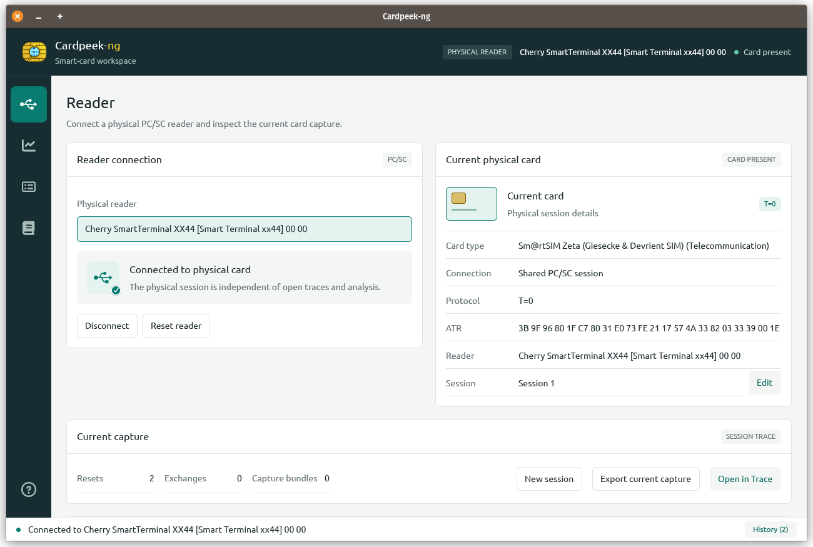
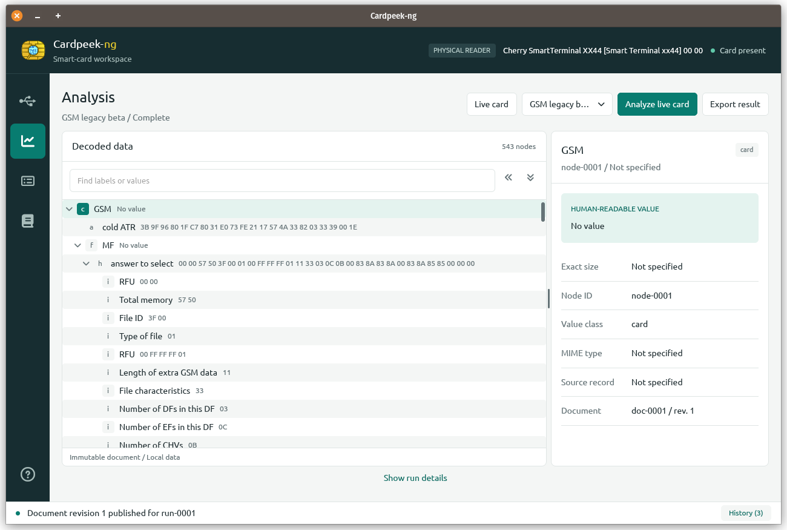
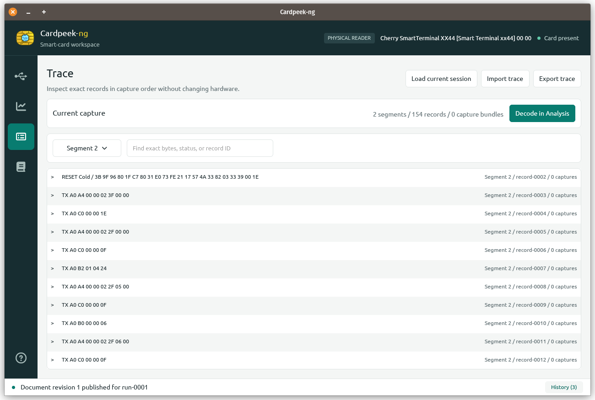
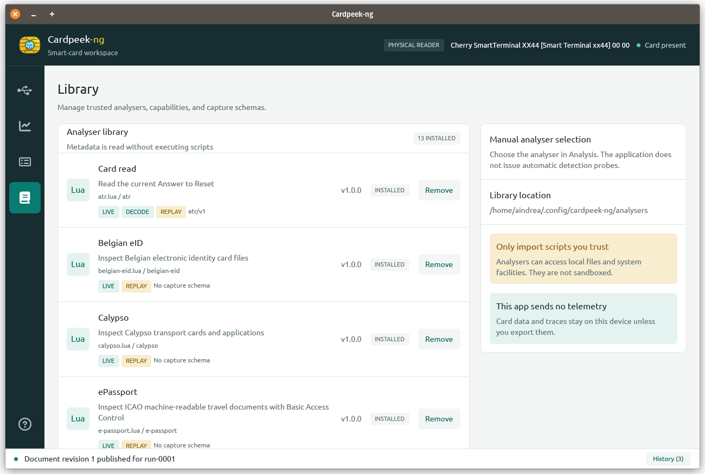

# Cardpeek-ng

Cardpeek-ng reads smart cards through PC/SC readers and uses [Lua analysers](docs/analysers.md) to decode their data.
It is useful for debugging smart card data and interactions, as well as forensic analysis.
The application exists as both a desktop GUI application and a CLI tool.
Alongside the readable results, commands and responses that produced them can be viewed and replayed in a trace view.
You can also save a trace and analyse it later without a card or reader.

## Why use Cardpeek-ng?

Flexibility was a key tenet in the design of this application, and analysers are modular and written in Lua.
Card interaction is separated from data formatting, so the analysers can format data offline from previously recorded interactions (traces).

Raw card commands and responses are hard to interpret on their own, so Cardpeek-ng links each decoded value to its source record.
You can inspect a card and save its results and communication without losing that connection, so testing custom analysers is easy.

Cardpeek-ng is inspired by the original [Cardpeek](https://github.com/l1l1/cardpeek) application, but is a re-implementation from scratch in Rust.
It does not support legacy Cardpeek scripts or files.

## How do I start?

### Requirements

To read a physical card, you need a PC/SC reader, a test card, and a running PC/SC service.
Building from source also requires the Rust toolchain specified by the project and the PC/SC development files.
On Debian or Ubuntu, install `pcscd`, `libpcsclite-dev`, `libgtk-3-dev`, `libxkbcommon-x11-dev`, and `pkg-config`; Windows and macOS provide their own PC/SC support.

Start with a disposable test card because card operations can change card state or expose personal data.
Do not experiment with a card whose contents or continued operation matter to you.

### Run the desktop application

From the project directory, run:

```sh
cargo run -p cardpeek-desktop
```

The application creates your analyser library on first use and installs the bundled analysers.

### Read your first card

1. Insert the test card into the reader.
2. Open **Reader**, select the physical reader, and select **Connect**.
3. Open **Analysis**.
4. Select **Live card** and choose an analyser.
   **ATR** reads the card's Answer to Reset.
   **GSM SIM and USIM** reads supported SIM files without authentication or writes.
5. Select **Analyze live card**.
6. Expand the result tree, or search for labels and values.
   Select an item to see its details.

Cardpeek-ng does not probe cards to choose an analyser, so select the one that matches your card.

## What do the workspaces show?

### Reader

The Reader workspace controls the physical card session and shows the current card, capture totals, and session exchanges.
From here you can connect or disconnect, reset the reader, and send an individual APDU.

Only send an APDU when you understand what it does.
A status word of `9000` means success, while other values report warnings, errors, or card-specific results.



### Analysis

The Analysis workspace runs a selected analyser against a live card or saved data, then presents the results as a searchable tree.
Select a result to inspect its value, type, and source information, or open the run details for progress and log messages.
Use **Export result** to keep the result document.



### Trace

A trace records resets, transmitted commands, received responses, and status words in order.
Card resets divide the trace into segments, and you can filter records or search for exact bytes, a status word, or a record ID.

- **Load current session** opens the current capture without contacting the card again.
- **Import trace** opens a saved trace for offline inspection.
- **Export trace** saves the current trace.
- **Decode in Analysis** analyses saved capture data without accessing a physical card.

Raw traces can contain card identifiers, personal data, and command or response data, so review exports before sharing them.
When you share a trace, use a sanitised export to redact the ATR and command and response data.



### Library

The Library workspace lists installed analysers with their versions and capabilities.
Use **Add analyser** to import Lua files or **Remove** to uninstall one.
The desktop and command-line applications share this library.

Lua analysers are trusted code and do not run in a security sandbox, so import only scripts that you trust and have reviewed.
For the scripting API and metadata format, see [Write analyser scripts](docs/analysers.md).



## Command-line alternative

The CLI supports the same card and trace tasks as the desktop application.
For example, list available readers with:

```sh
cargo run -p cardpeek-cli -- readers
```

## Privacy and compatibility

Cardpeek-ng sends no telemetry, and exported result documents and traces stay on your device until you share them.
Review exports for sensitive information first.

Cardpeek-ng uses its own Lua API and native JSON document and trace formats, which are not compatible with legacy Cardpeek analysers, XML documents, or trace captures.

For native install packages, see [Package builders](docs/packaging.md).
For hardware checks, see [PC/SC hardware tests](docs/hardware-tests.md).
Cardpeek-ng is distributed under [GPL-3.0-or-later](LICENSE).

[](https://github.com/xfoa/Cardpeek-ng/actions/workflows/ci.yml)